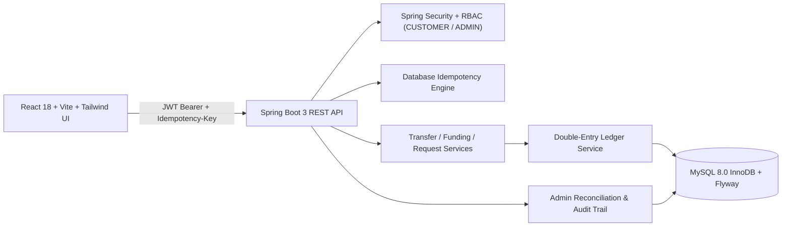

# DhanPay — FinTech Transaction Processing Engine

DhanPay is a double-entry general ledger and wallet transaction processing platform built with **Java 17**, **Spring Boot 3.3.5**, **MySQL 8.0 (InnoDB)**, **Flyway (`V1`–`V7`)**, and **React 18 + Vite + Tailwind CSS**.

## Architecture



## Core Capabilities

- **Double-Entry Accounting**: Every monetary movement posts a balanced batch of `DEBIT` and `CREDIT` `ledger_entries` inside `ledger_transactions`. Total debits always equal total credits across `GL-SYS-HOLDING-INR-0001` and customer `ledger_accounts`.
- **Strict Fixed-Point Arithmetic**: All amounts use `DECIMAL(19,4)` with MySQL `CHECK` constraints (`balance >= 0.0000`, positive entry/transfer amounts, distinct sender/recipient wallets).
- **Concurrency & Idempotency**: Deterministic lowest-ID-first pessimistic row locks (`SELECT ... FOR UPDATE`) prevent deadlocks, and `idempotency_records` caches SHA-256 request fingerprints and JSON responses for `(user_id, idempotency_key)`.
- **Wallet Funding & Peer Workflows**: Self-service idempotent wallet top-ups (`Fund Account`), saved recipient contacts (`Beneficiaries`), and incoming/outgoing P2P `Payment Requests` with one-click settlement.
- **Velocity Limits & Governance**: Rolling 24-hour debit outflow limit (`₹1,00,000.00`), single transfer cap (`₹50,000.00`), user password updates, admin wallet freeze/unfreeze controls, ledger journal drilldown, and live global ledger reconciliation.

## API Endpoints

| Area | Method & Path | Description |
| :--- | :--- | :--- |
| **Auth** | `POST /api/auth/register` | Register customer & auto-provision INR wallet + GL account |
| **Auth** | `POST /api/auth/login` | Authenticate credentials and issue JWT Bearer token |
| **Auth** | `PATCH /api/auth/password` | Change password for authenticated user |
| **Wallets** | `GET /api/wallets/me` | Fetch materialized balance, status, and linked GL account |
| **Wallets** | `GET /api/wallets/limits` | Inspect single transfer cap & rolling 24h outflow usage |
| **Wallets** | `POST /api/wallets/topup` | Idempotent wallet funding from `GL-SYS-HOLDING-INR-0001` |
| **Transfers** | `POST /api/transfers` | Execute atomic P2P INR transfer (`Idempotency-Key` required) |
| **Transfers** | `GET /api/transfers` | Paginated history with search, status, and direction filters |
| **Transfers** | `GET /api/transfers/{ref}/journal` | Inspect balanced double-entry `DEBIT`/`CREDIT` lines |
| **Beneficiaries** | `GET / POST / DELETE /api/beneficiaries` | Manage saved recipient `WLT-IND-...` contacts |
| **Requests** | `GET / POST /api/requests` | Create and list incoming/outgoing payment requests |
| **Requests** | `POST /api/requests/{ref}/pay` | Pay pending request via idempotent transfer settlement |
| **Requests** | `POST /api/requests/{ref}/decline` | Decline (payer) or cancel (requester) pending request |
| **Admin** | `GET /api/admin/stats` & `/reconciliation` | System metrics and live ledger balance audit (`ROLE_ADMIN`) |
| **Admin** | `GET /api/admin/users` & `/audit-logs` | Paginated customer search and immutable audit trail |
| **Admin** | `PATCH /api/admin/wallets/{id}/freeze` & `/unfreeze` | Freeze/unfreeze wallets with mandatory audit reason |

## Flyway Schema Migrations (`V1`–`V7`)

- `V1__init_schema.sql`: Core `users`, `wallets`, `transfers`, `ledger_accounts`, `ledger_transactions`, `ledger_entries`, `idempotency_records`, `audit_logs`
- `V2__seed_system_and_demo.sql`: Seeds `GL-SYS-HOLDING-INR-0001` and demo accounts
- `V3__align_customer_wallet_account_type.sql` – `V5__align_idempotency_status.sql`: Enum & constraint alignment
- `V6__create_beneficiaries.sql`: Saved recipient contacts book
- `V7__create_payment_requests.sql`: P2P INR payment request lifecycle

## Seeded Demo Accounts (`V2__seed_system_and_demo.sql`)

| Role | Name | Email | Password | Wallet Ref | Opening Balance (INR) |
| :--- | :--- | :--- | :--- | :--- | ---: |
| `ROLE_ADMIN` | DhanPay System Admin | `admin@dhanpay.internal` | `Admin@1234` | `WLT-SYS-ADMIN-0001` | `0.0000` |
| `ROLE_CUSTOMER` | Aarav Sharma | `aarav@example.com` | `Customer@1234` | `WLT-IND-10000002` | `25,000.0000` |
| `ROLE_CUSTOMER` | Priya Patel | `priya@example.com` | `Customer@1234` | `WLT-IND-10000003` | `15,000.0000` |
| `ROLE_CUSTOMER` | Rohan Verma | `rohan@example.com` | `Customer@1234` | `WLT-IND-10000004` | `10,000.0000` |

## Quick Start

### Option 1: Local MySQL + IntelliJ / Maven + Vite
1. Start MySQL 8.0 locally (default fallback in `backend/src/main/resources/application.yml` creates `dhanpay` automatically).
2. Run the backend:
   ```bash
   cd backend
   mvn spring-boot:run
   ```
3. Run the frontend (`http://localhost:5173`):
   ```bash
   cd frontend
   npm install
   npm run dev
   ```
4. Verify Swagger UI at `http://localhost:8080/swagger-ui.html` and health at `http://localhost:8080/actuator/health`.

### Option 2: Docker Compose
1. Copy `.env.example` to `.env` and adjust credentials if needed.
2. Start MySQL and backend:
   ```bash
   docker compose up --build -d
   ```

## Phase 3 Operational Endpoints
- **Admin Transfer Reversal**: `GET /api/admin/transfers`, `POST /api/admin/transfers/{reference}/reverse` (posts compensating `REVERSAL` double-entry ledger entries)
- **Escrow Holds**: `GET /api/escrow`, `POST /api/escrow`, `POST /api/escrow/{reference}/release`, `POST /api/escrow/{reference}/refund` (backed by `V8__create_escrow_holds.sql` and `GL-SYS-ESCROW-INR-0001`)
- **Security & Automation**: Sliding-window `RateLimitingFilter` (`429 Too Many Requests` on `/api/auth/login` and `/api/transfers`) and `ScheduledReconciliationJob` (`SCHEDULED_LEDGER_AUDIT`)
- **Real-Time Notifications**: `GET /api/notifications/stream` (authenticated SSE stream for incoming transfers, payment requests, escrow updates, reversals, and wallet status changes)
