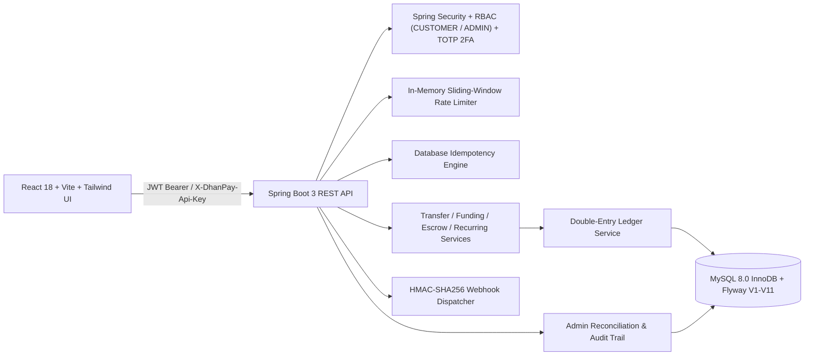

# DhanPay — FinTech Transaction Processing Engine

DhanPay is a production-grade, double-entry general ledger and wallet transaction processing platform built with **Java 17**, **Spring Boot 3.3.5**, **MySQL 8.0 (InnoDB)**, **Flyway (`V1`–`V11`)**, and **React 18 + Vite + Tailwind CSS**.

## Architecture



## Core Capabilities

- **Double-Entry Accounting**: Every monetary movement posts a strictly balanced batch of `DEBIT` and `CREDIT` `ledger_entries` inside `ledger_transactions`. Total debits always equal total credits across `GL-SYS-HOLDING-INR-0001`, `GL-SYS-ESCROW-INR-0001`, and customer liability accounts.
- **Strict Fixed-Point Precision**: All monetary values use `DECIMAL(19,4)` with database `CHECK` constraints (`balance >= 0.0000`, positive entry/transfer amounts, distinct sender/recipient wallets).
- **Concurrency & Idempotency**: Deterministic lowest-ID-first pessimistic row locking (`SELECT ... FOR UPDATE`) prevents deadlocks under high concurrency. `idempotency_records` caches SHA-256 request fingerprints and JSON response payloads for `(user_id, idempotency_key)`.
- **Escrow Hold & Release Engine**: Safe peer-to-peer conditional milestone holding backed by system escrow ledger account `GL-SYS-ESCROW-INR-0001`.
- **Dynamic QR Code Payments**: Standalone zero-dependency SVG QR generator (ISO/IEC 18004) producing static wallet QR codes and dynamic payment intent codes with UPI URI parsing (`upi://pay?pa=...`).
- **Two-Factor Authentication (TOTP 2FA)**: RFC 6238 TOTP engine compatible with Google Authenticator, Authy, and 1Password. Features single-use backup recovery codes and mandatory step-up authentication for high-value transfers (> ₹10,000).
- **Automated Recurring Transfers (SIP & Subscriptions)**: Standing order engine supporting `DAILY`, `WEEKLY`, `MONTHLY`, and `QUARTERLY` schedules with automated background execution (`ScheduledRecurringJob`), failure recovery, and pause/resume lifecycle controls.
- **Official Certified Account Statements**: Audit-compliant opening/closing balance calculation derived directly from immutable ledger lines. Includes tamper-evident SHA-256 cryptographic integrity hash and printable HTML letterhead with `@media print` styling and RBI compliance stamps.
- **Developer & Merchant Platform**: Cryptographically secure API keys (`dp_live_...` / `dp_test_...`) with SHA-256 hash storage, `ApiKeyAuthenticationFilter` for headless server authentication, and HMAC-SHA256 cryptographically signed webhook notifications (`X-DhanPay-Signature: t=...,v1=...`).
- **Velocity Limits & Real-Time Stream**: Rolling 24-hour outflow limit (`₹1,00,000.00`), single transfer cap (`₹50,000.00`), in-memory sliding-window rate limiting, and real-time Server-Sent Events (SSE) notification stream.

---

## Complete API Reference

| Module | Method & Path | Description |
| :--- | :--- | :--- |
| **Auth** | `POST /api/auth/register` | Register customer & auto-provision INR wallet + GL account |
| **Auth** | `POST /api/auth/login` | Authenticate credentials and issue JWT Bearer token |
| **Auth** | `PATCH /api/auth/password` | Change password for authenticated user |
| **2FA** | `GET /api/auth/2fa/status` | Check TOTP 2FA status and remaining backup codes |
| **2FA** | `POST /api/auth/2fa/setup` | Generate new TOTP Base32 secret and `otpauth://` URI |
| **2FA** | `POST /api/auth/2fa/enable` | Verify 6-digit TOTP code and issue 8 recovery backup codes |
| **2FA** | `POST /api/auth/2fa/disable` | Disable 2FA with password and TOTP code verification |
| **Wallets** | `GET /api/wallets/me` | Fetch materialized balance, status, and linked GL account |
| **Wallets** | `GET /api/wallets/limits` | Inspect single transfer cap & rolling 24h outflow usage |
| **Wallets** | `POST /api/wallets/topup` | Idempotent wallet funding from `GL-SYS-HOLDING-INR-0001` |
| **Statements** | `GET /api/wallets/statement` | Certified statement in JSON or printable HTML with SHA-256 seal |
| **Statements** | `GET /api/wallets/statement/download` | Download printable certified statement document |
| **Transfers** | `POST /api/transfers` | Execute atomic P2P INR transfer (`Idempotency-Key` required) |
| **Transfers** | `GET /api/transfers` | Paginated history with search, status, and direction filters |
| **Transfers** | `GET /api/transfers/{ref}/journal` | Inspect balanced double-entry `DEBIT`/`CREDIT` ledger lines |
| **QR Engine** | `GET /api/qr/my-code` | Standalone SVG QR code for current user's wallet |
| **QR Engine** | `POST /api/qr/generate` | Generate dynamic SVG QR with embedded amount and note |
| **QR Engine** | `POST /api/qr/parse` | Parse DhanPay wallet or UPI payment URI string |
| **Escrow** | `POST /api/escrow` | Create conditional escrow hold from customer wallet |
| **Escrow** | `GET /api/escrow` | List incoming and outgoing escrow holds |
| **Escrow** | `POST /api/escrow/{ref}/release` | Release held escrow funds to seller wallet |
| **Escrow** | `POST /api/escrow/{ref}/refund` | Refund escrow hold back to buyer wallet |
| **Recurring** | `POST /api/recurring` | Schedule automated standing order (Daily/Weekly/Monthly/Quarterly) |
| **Recurring** | `GET /api/recurring` | List active, paused, and completed standing orders |
| **Recurring** | `PATCH /api/recurring/{ref}/pause` | Pause recurring transfer schedule |
| **Recurring** | `PATCH /api/recurring/{ref}/resume` | Resume paused recurring transfer schedule |
| **Recurring** | `DELETE /api/recurring/{ref}` | Cancel standing order rule |
| **Developer** | `POST /api/developer/keys` | Generate new API key (`dp_live_...` or `dp_test_...`) |
| **Developer** | `GET /api/developer/keys` | List active and revoked API keys |
| **Developer** | `DELETE /api/developer/keys/{id}` | Revoke API key |
| **Developer** | `POST /api/developer/webhooks` | Register signed webhook destination endpoint |
| **Developer** | `GET /api/developer/webhooks` | List registered webhooks and signing secrets |
| **Developer** | `DELETE /api/developer/webhooks/{id}` | Delete webhook endpoint |
| **Developer** | `POST /api/developer/webhooks/{id}/test` | Dispatch signed HMAC-SHA256 test ping |
| **Developer** | `GET /api/developer/webhooks/{id}/deliveries` | Audit log of recent webhook deliveries and HTTP status codes |
| **Beneficiaries** | `GET / POST / DELETE /api/beneficiaries` | Manage saved recipient `WLT-IND-...` contacts |
| **Requests** | `GET / POST /api/requests` | Create and list incoming/outgoing payment requests |
| **Requests** | `POST /api/requests/{ref}/pay` | Settle pending request via idempotent transfer |
| **Requests** | `POST /api/requests/{ref}/decline` | Decline or cancel pending request |
| **Notifications** | `GET /api/notifications/stream` | Real-time Server-Sent Events (SSE) stream |
| **Admin** | `GET /api/admin/stats` & `/reconciliation` | System metrics and live ledger balance audit (`ROLE_ADMIN`) |
| **Admin** | `GET /api/admin/users` & `/audit-logs` | Paginated customer search and immutable audit trail |
| **Admin** | `PATCH /api/admin/wallets/{id}/freeze` & `/unfreeze` | Freeze/unfreeze wallets with mandatory audit reason |
| **Admin** | `GET /api/admin/transfers` | Admin system-wide transaction search |
| **Admin** | `POST /api/admin/transfers/{ref}/reverse` | Reverse fraudulent transfer via compensating ledger entry |

---

## Flyway Schema Migrations (`V1`–`V11`)

- `V1__init_schema.sql`: Core `users`, `wallets`, `transfers`, `ledger_accounts`, `ledger_transactions`, `ledger_entries`, `idempotency_records`, `audit_logs`
- `V2__seed_system_and_demo.sql`: Seeds `GL-SYS-HOLDING-INR-0001` and demo user accounts
- `V3__align_customer_wallet_account_type.sql` – `V5__align_idempotency_status.sql`: Enum and constraint alignments
- `V6__create_beneficiaries.sql`: Saved recipient contacts book
- `V7__create_payment_requests.sql`: P2P INR payment request lifecycle
- `V8__create_escrow_holds.sql`: Escrow milestone holds backed by `GL-SYS-ESCROW-INR-0001`
- `V9__add_two_factor_auth_to_users.sql`: TOTP 2FA secrets, status, and encrypted backup codes
- `V10__create_recurring_transfers.sql`: Standing orders & automated SIP schedule definitions
- `V11__create_merchant_api_keys_and_webhooks.sql`: Merchant API keys, webhook endpoints, and delivery logs

---

## Seeded Demo Accounts (`V2__seed_system_and_demo.sql`)

| Role | Name | Email | Password | Wallet Ref | Opening Balance (INR) |
| :--- | :--- | :--- | :--- | :--- | ---: |
| `ROLE_ADMIN` | DhanPay System Admin | `admin@dhanpay.internal` | `Admin@1234` | `WLT-SYS-ADMIN-0001` | `0.0000` |
| `ROLE_CUSTOMER` | Aarav Sharma | `aarav@example.com` | `Customer@1234` | `WLT-IND-10000002` | `25,000.0000` |
| `ROLE_CUSTOMER` | Priya Patel | `priya@example.com` | `Customer@1234` | `WLT-IND-10000003` | `15,000.0000` |
| `ROLE_CUSTOMER` | Rohan Verma | `rohan@example.com` | `Customer@1234` | `WLT-IND-10000004` | `10,000.0000` |

---

## Quick Start

### Option 1: Local Development
1. Start MySQL 8.0 locally. Default configuration in `backend/src/main/resources/application.yml` automatically executes Flyway migrations `V1` through `V11`.
2. Run the backend:
   ```bash
   cd backend
   mvn spring-boot:run
   ```
3. Run the frontend (`http://localhost:5173`):
   ```bash
   cd frontend
   npm install
   npm run dev
   ```
4. Verify Swagger UI at `http://localhost:8080/swagger-ui.html` and health at `http://localhost:8080/actuator/health`.

### Option 2: Docker Compose
1. Copy `.env.example` to `.env` and adjust credentials if needed.
2. Start MySQL and backend:
   ```bash
   docker compose up --build -d
   ```

### Test Suite Execution
Run the comprehensive 53-unit-test suite:
```bash
cd backend
mvn test
```
All 53 unit tests cover double-entry ledger balancing, transfer concurrency, escrow lifecycle, TOTP verification, QR encoding, recurring schedules, certified statements, API key authentication, and HMAC-SHA256 webhook signatures.
