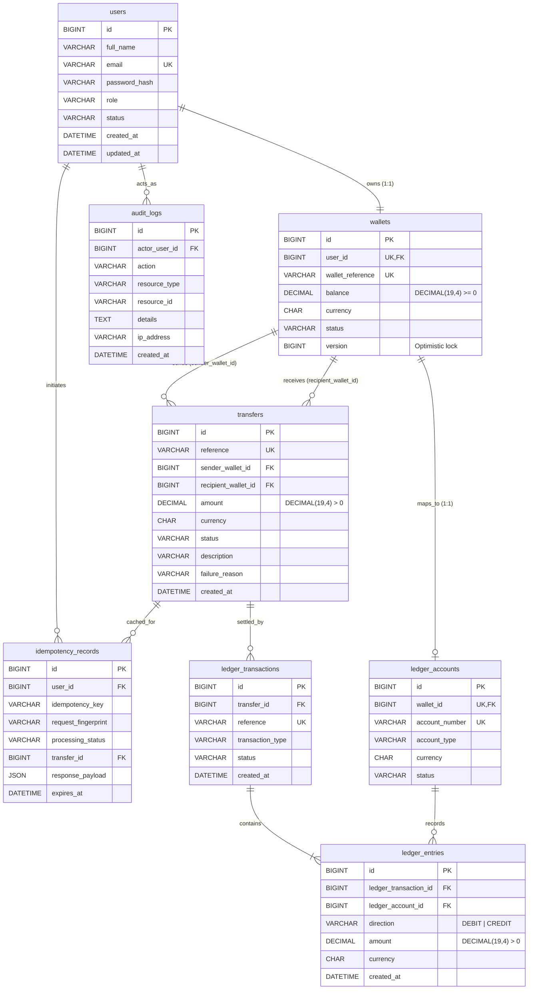

# DhanPay — Architecture, Code Review & Interview Preparation Guide

> **Tagline:** *Secure Transfers. Smarter Money Management.*  
> **Stack:** Java 17, Spring Boot 3.3.5, Spring Security (Stateless JWT), Spring Data JPA / Hibernate (`ddl-auto: validate`, `open-in-view: false`), MySQL 8.0 InnoDB, Flyway (`V1`–`V5`), Testcontainers, React 18, Vite, Tailwind CSS, Axios, Lucide Icons.

---

## 1. Architecture & Design Review

### 1.1 SOLID Principles, Transaction Boundaries & Exception Handling
- **Single Responsibility & Layered Boundaries:**
  - `AuthController` / `WalletController` / `TransferController` / `AdminController` are thin REST adapters handling HTTP semantics, Bean Validation (`@Valid`), and `@AuthenticationPrincipal UserPrincipal` extraction.
  - Core domain orchestration is isolated in `AuthService`, `TransferService`, `LedgerService`, `ReconciliationService`, `IdempotencyService`, `AuditService`, and `AdminService`.
- **Transaction Boundaries Observed:**
  - `AuthService.register`: `@Transactional` atomically creates `User`, `Wallet` (`0.0000`), and `LedgerAccount` (`CUSTOMER_WALLET`).
  - `TransferService.executeTransfer`: `@Transactional(isolation = Isolation.READ_COMMITTED, rollbackFor = Exception.class)` wraps limit validation, ordered pessimistic locking, debit/credit, `Transfer` persistence, double-entry ledger posting, audit logging, and idempotency completion.
  - `LedgerService.recordTransfer`: `@Transactional(propagation = Propagation.MANDATORY)` guarantees ledger entries cannot be created outside a parent financial transaction.
  - `IdempotencyService`: `lockOrRetrieve` and `markFailed` use `Propagation.REQUIRES_NEW` so idempotency reservations persist independently even when the parent transfer rolls back.
  - **Code Review Fix Applied (`IdempotencyService.markSuccess`):** Changed `markSuccess` from `Propagation.REQUIRES_NEW` to `Propagation.REQUIRED`. Because `idempotency_records.transfer_id` has a foreign key (`fk_idempotency_transfer`) referencing the newly inserted uncommitted `transfers.id`, a separate `REQUIRES_NEW` transaction could block on the outer transaction's row lock or commit `COMPLETED` ahead of an outer rollback. Participating in the outer transaction guarantees atomic commit of `transfers`, `wallets`, `ledger_entries`, `audit_logs`, and `idempotency_records`.
  - **Environment Config Fix Applied (`.env.example`):** Updated `VITE_API_BASE_URL` from `http://localhost:8080/api/v1` to `http://localhost:8080/api` to match controller mappings (`/api/auth`, `/api/wallets`, `/api/transfers`, `/api/admin`).
- **Centralized Exception Handling:**
  - `GlobalExceptionHandler` translates `BusinessException`, `ConflictException`, `ResourceNotFoundException`, `MethodArgumentNotValidException`, `OptimisticLockingFailureException`, `AccessDeniedException`, and authentication failures into consistent `ApiErrorResponse` JSON payloads.

### 1.2 Monetary Precision (`BigDecimal` & Database `DECIMAL(19,4)`)
- Every SQL monetary column (`wallets.balance`, `transfers.amount`, `ledger_entries.amount`) uses `DECIMAL(19,4)` with `CHECK` constraints (`balance >= 0.0000`, `amount > 0.0000`).
- `Wallet` normalizes values to scale `4` (`RoundingMode.HALF_EVEN`).
- `LedgerService`, `LedgerEntry`, `IdempotencyService`, and `TransferService` enforce `scale(4, RoundingMode.UNNECESSARY)` when posting or fingerprinting validated transfer amounts, preventing silent truncation or IEEE-754 floating-point drift.

### 1.3 Indexing & N+1 Query Review
- **Index Coverage (`V1__init_schema.sql`):**
  - `users`: `uk_users_email`, `idx_users_role_status`.
  - `wallets`: `uk_wallets_user_id`, `uk_wallets_reference`, `idx_wallets_status`.
  - `transfers`: `uk_transfers_reference`, `idx_transfers_sender_created`, `idx_transfers_recipient_created`, `idx_transfers_status_created`.
  - `ledger_accounts`: `uk_ledger_accounts_wallet_id`, `uk_ledger_accounts_account_number`, `idx_ledger_accounts_type_status`.
  - `ledger_entries`: `idx_ledger_entries_tx_id`, `idx_ledger_entries_account_created`, `idx_ledger_entries_account_direction`.
  - `idempotency_records`: `uk_idempotency_user_key (user_id, idempotency_key)`, `idx_idempotency_expires_at`, `idx_idempotency_transfer_id`.
  - `audit_logs`: `idx_audit_logs_actor_created`, `idx_audit_logs_resource`, `idx_audit_logs_action_created`.
- **N+1 Analysis:**
  - `TransferRepository.findWalletHistory` and `WalletRepository.findCustomerWallets` use `JOIN FETCH` with explicit `countQuery` definitions, avoiding N+1 fetches under `open-in-view: false`.
  - `AdminService.getAuditLogs` batches actor lookups via `userRepository.findAllById(actorIds)` (1 query per page rather than 1 per row).
  - **Known Optimization Opportunity (`ReconciliationService.reconcileAllWallets`):** Currently executes `1 + 3N` queries (`walletRepository.findAll()`, then per wallet: `findByWalletId` + 2 `SUM` queries). All queries hit unique/composite indexes, which is sound at low-to-medium scale; at high wallet counts, replace with a single `GROUP BY ledger_account_id, direction` aggregation query.

### 1.4 Optimistic + Pessimistic Locking Interaction
- `Wallet` has `@Version` (`wallets.version`) for optimistic concurrency control and `WalletRepository.findByIdWithLock` (`@Lock(LockModeType.PESSIMISTIC_WRITE)` -> `SELECT ... FOR UPDATE`) for financial mutations in `TransferService` and `AdminService`.
- Because `TransferService` runs at `READ_COMMITTED` and acquires `FOR UPDATE` row locks in deterministic primary-key order before reading balances or versions, concurrent threads serialize cleanly on the InnoDB row lock and increment `version` without conflicting `OptimisticLockingFailureException` races, while `@Version` still guards any non-locked write path against lost updates.

---

## 2. Technical Documentation

### 2.1 System Architecture Diagram

```text
+-----------------------------------------------------------------------+
|                       React 18 SPA (Vite + Tailwind)                  |
|   Login / Register | Dashboard | Send Money | History | Admin Console |
|         Axios Client (JWT Bearer + UUID Idempotency-Key header)       |
+-----------------------------------+-----------------------------------+
                                    | HTTPS / REST (/api/*)
                                    v
+-----------------------------------------------------------------------+
|                     Spring Boot 3.3.5 (Java 17)                       |
|                                                                       |
|  +-----------------------------------------------------------------+  |
|  | Spring Security Filter Chain (Stateless JWT, RBAC, CORS)        |  |
|  |   Public: /api/auth/**, /swagger-ui/**, /actuator/health        |  |
|  |   Customer/Admin: /api/wallets/**, /api/transfers/**            |  |
|  |   Admin Only: /api/admin/**                                     |  |
|  +-----------------------------------------------------------------+  |
|                                    |                                  |
|  +-----------------+   +-----------+----------+   +----------------+  |
|  | AuthController  |   | TransferController & |   | AdminController|  |
|  | & AuthService   |   | WalletController     |   | & AdminService |  |
|  +-----------------+   +-----------+----------+   +-------+--------+  |
|                                    |                      |           |
|                        +-----------v----------------------v--------+  |
|                        | TransferService (READ_COMMITTED)          |  |
|                        |  1. IdempotencyService (SHA-256 + Lock)   |  |
|                        |  2. Ordered Pessimistic Locks (min->max)  |  |
|                        |  3. Debit / Credit Wallets (@Version)     |  |
|                        |  4. LedgerService (MANDATORY double-entry)|  |
|                        |  5. AuditService (Immutable audit_logs)   |  |
|                        +---------------------+---------------------+  |
|                                              |                        |
|                        +---------------------v---------------------+  |
|                        | ReconciliationService (Read-Only Audit)   |  |
|                        +---------------------+---------------------+  |
+----------------------------------------------+------------------------+
                                               | JDBC / HikariCP (20 max)
                                               v
+-----------------------------------------------------------------------+
|                     MySQL 8.0 InnoDB + Flyway (V1-V5)                 |
|  users | wallets | transfers | ledger_accounts | ledger_transactions  |
|        | ledger_entries (append-only) | idempotency_records | audit_logs |
+-----------------------------------------------------------------------+
```

### 2.2 Database Entity Relationship Diagram (Mermaid ERD)



### 2.3 Local Run Guide

#### Option A: Docker Compose (MySQL 8.0 + Spring Boot Backend) + Local Vite Frontend
1. Copy `.env.example` to `.env`:
   ```powershell
   cd D:\GITDEMO\DhanPay
   Copy-Item .env.example .env
   ```
2. Start MySQL and Backend containers:
   ```powershell
   docker compose up --build -d
   ```
3. Verify services:
   - Health: `http://localhost:8080/actuator/health`
   - Swagger UI: `http://localhost:8080/swagger-ui.html`
4. Start the React frontend:
   ```powershell
   cd D:\GITDEMO\DhanPay\frontend
   npm install
   npm run dev
   ```
   Open `http://localhost:5173`.

#### Option B: Bare Metal (Local JDK 17 + MySQL 8.0 + Maven + Node.js)
1. Ensure **Java 17**, **Maven 3.9+**, **Node.js 18+**, and a running **MySQL 8.0** instance are available.
2. Create the database and user (or use root matching `application.yml`):
   ```sql
   CREATE DATABASE IF NOT EXISTS dhanpay CHARACTER SET utf8mb4 COLLATE utf8mb4_unicode_ci;
   CREATE USER IF NOT EXISTS 'dhanpay_app'@'localhost' IDENTIFIED BY 'dhanpay_secret';
   GRANT ALL PRIVILEGES ON dhanpay.* TO 'dhanpay_app'@'localhost';
   FLUSH PRIVILEGES;
   ```
3. Run the backend (Flyway runs `V1`–`V5` automatically on startup):
   ```powershell
   cd D:\GITDEMO\DhanPay\backend
   mvn spring-boot:run
   ```
4. Run the frontend:
   ```powershell
   cd D:\GITDEMO\DhanPay\frontend
   npm install
   npm run dev
   ```
5. Seeded demo credentials (`V2__seed_system_and_demo.sql`):
   - **Customer:** `aarav@example.com` / `Customer@1234` (Wallet `WLT-IND-10000002`, ₹25,000.0000)
   - **Customer:** `priya@example.com` / `Customer@1234` (Wallet `WLT-IND-10000003`, ₹15,000.0000)
   - **Customer:** `rohan@example.com` / `Customer@1234` (Wallet `WLT-IND-10000004`, ₹10,000.0000)
   - **Admin:** `admin@dhanpay.internal` / `Admin@1234`

### 2.4 Test Suite Inventory & Execution Summary
- **Unit Tests:**
  - `JwtTokenProviderTest`
  - `AuthServiceTest`
  - `LedgerServiceTest`
  - `ReconciliationServiceTest`
  - `TransferServiceTest`
  - `IdempotencyServiceTest`
- **Testcontainers MySQL Integration & Stress Tests:**
  - `BaseIntegrationTest` (`mysql:8.0.36` + Flyway)
  - `TransferConcurrencyTest` (Double-spending prevention + 10-thread bidirectional deadlock freedom)
  - `IdempotencyIntegrationTest` (201 creation, replay without double debit, 409 fingerprint mismatch)
  - `ReconciliationTest` (Balanced ledger audit + direct corruption detection)
- **Verification Status:** Compilation and test execution were **not run in this environment** because the sandbox has no access to Maven Central or Docker. Run locally with JDK 17 + Docker via:
  ```powershell
  mvn -f D:\GITDEMO\DhanPay\backend\pom.xml test
  ```

---

## 3. FinTech Technical Interview Preparation (5 Core Questions)

1. **Concurrency Control — How does DhanPay prevent double-spending during simultaneous debits?**
   - **Model Answer:** DhanPay combines InnoDB pessimistic row-level write locks (`@Lock(LockModeType.PESSIMISTIC_WRITE)` -> `SELECT ... FOR UPDATE` in `WalletRepository.findByIdWithLock`) with `Isolation.READ_COMMITTED` inside `TransferService.executeTransfer`. When two threads simultaneously try to debit ₹700 from a ₹1,000 wallet, the first thread acquires the exclusive row lock on `wallets`, reads `1000.0000`, debits to `300.0000`, posts ledger entries, and commits. The second thread blocks at `SELECT ... FOR UPDATE` until Thread 1 commits; under `READ_COMMITTED`, Thread 2 then sees the freshly committed `300.0000` balance (unlike `REPEATABLE_READ` consistent snapshot reads) and fails cleanly with `INSUFFICIENT_FUNDS`, backed further by the MySQL `CHECK (balance >= 0.0000)` constraint.

2. **Deadlock Elimination — Why does ordered locking (`min(A, B) -> max(A, B)`) eliminate circular wait graphs?**
   - **Model Answer:** Deadlocks require four Coffman conditions, including *circular wait* (Tx1 locks Wallet A then waits for Wallet B, while Tx2 locks Wallet B then waits for Wallet A). In `TransferService.executeTransfer`, both transfers compute `firstLockId = Math.min(senderId, recipientId)` and `secondLockId = Math.max(senderId, recipientId)` before issuing `findByIdWithLock`. Every transaction acquires row locks in strictly increasing primary-key order, converting the lock-wait graph into a directed acyclic graph (DAG) so circular wait is mathematically impossible.

3. **Idempotency — How does database-backed idempotency handle network timeouts and retries?**
   - **Model Answer:** Clients send a unique `Idempotency-Key` UUID per logical payment attempt. `IdempotencyService.computeFingerprint` builds a SHA-256 digest of `recipientWalletReference | amount(4dp) | description`. `lockOrRetrieve` runs in `Propagation.REQUIRES_NEW`, inserting a `PROCESSING` record guarded by `UNIQUE (user_id, idempotency_key)` (`uk_idempotency_user_key`). Simultaneous duplicate requests hit `DataIntegrityViolationException` or see `PROCESSING` and receive `409 CONCURRENT_REQUEST`. If a client times out after the server committed the transfer and retries with the same key and payload, `lockOrRetrieve` sees `COMPLETED` and returns the cached JSON `response_payload` immediately without touching wallets or the ledger; if the payload changed for the same key, it rejects with `409 IDEMPOTENCY_MISMATCH`.

4. **Double-Entry Bookkeeping — Why are wallet balances materialized caches while the append-only ledger is the source of truth?**
   - **Model Answer:** A wallet's `balance` column is a materialized read/lock cache optimized for `O(1)` balance checks under `SELECT ... FOR UPDATE`. The authoritative system of record is the immutable, append-only pair of `ledger_transactions` and `ledger_entries` (`@Immutable` entities, repositories extending `Repository` without update/delete methods, `ON DELETE RESTRICT` foreign keys). Every transfer posts a balanced `DEBIT` on the sender's `LedgerAccount` and `CREDIT` on the recipient's `LedgerAccount`, asserted by `LedgerService.assertBalanced`. `ReconciliationService.reconcileAllWallets` verifies the invariant `wallet.balance == SUM(Credits) - SUM(Debits)` and global `SUM(Debits) == SUM(Credits)`, isolating any out-of-band drift.

5. **ACID Invariants — What happens at `READ_COMMITTED` during partial failures, and how is rollback guaranteed?**
   - **Model Answer:** `TransferService.executeTransfer` is annotated with `@Transactional(isolation = Isolation.READ_COMMITTED, rollbackFor = Exception.class)`. Note that Spring's default rollback behavior only rolls back on unchecked (`RuntimeException`) exceptions, whereas `rollbackFor = Exception.class` ensures even checked exceptions (e.g., `JsonProcessingException` when serializing the idempotency cache) roll back the entire transaction. Because `LedgerService.recordTransfer` (`Propagation.MANDATORY`), `AuditService.logAction` (`Propagation.REQUIRED`), and `IdempotencyService.markSuccess` (`Propagation.REQUIRED`) all share the same database transaction, a failure at any step rolls back wallet debits, wallet credits, `transfers`, `ledger_transactions`, `ledger_entries`, and `audit_logs` together. Afterward, the `catch` block calls `IdempotencyService.markFailed` (`Propagation.REQUIRES_NEW`) in an isolated transaction so the client can safely retry.

---

## 4. Production Readiness & Known Boundaries

- **Daily Velocity Limits Not Yet Enforced in Runtime Path:** `application.yml` defines `daily-velocity-limit-amount` (`200000.0000`) and `daily-velocity-max-count` (`25`), while `TransferService` currently enforces single-transfer min/max bounds (`₹1.0000`–`₹50,000.0000`). Wire `@ConfigurationProperties` and sum recent 24h `SUCCESS` transfers for the sender wallet before debiting.
- **Transactional Outbox Pattern for Async Notifications/Analytics:** Webhooks, SMS/email receipts, and fraud scoring should not run synchronously inside the `READ_COMMITTED` lock window. Persist domain events into an `outbox_events` table inside the same DB transaction and publish asynchronously to Kafka/RabbitMQ via a polling relay or Debezium CDC.
- **Distributed Rate Limiting:** Add a Redis-backed token bucket (e.g., Bucket4j + Redis or API Gateway) per IP and per `userId` on `/api/auth/**` and `/api/transfers` to mitigate brute-force and transfer spam across horizontally scaled backend instances.
- **Reconciliation Batch Optimization:** Replace `ReconciliationService`'s per-wallet queries with a single SQL `GROUP BY ledger_account_id, direction` query and run scheduled periodic reconciliation jobs alongside the on-demand admin trigger.
- **JWT Key Rotation & Revocation:** Support short-lived access tokens + refresh token rotation and a Redis token blocklist (by `jti`) for immediate admin/user session revocation, plus externalized secret management (Vault / KMS) instead of default fallback secrets.
- **Ledger Table Partitioning & Idempotency TTL Cleanup:** Partition `ledger_entries` and `audit_logs` by `created_at` (monthly/yearly) and schedule an automated purge job using `idx_idempotency_expires_at` (`24h` TTL).
